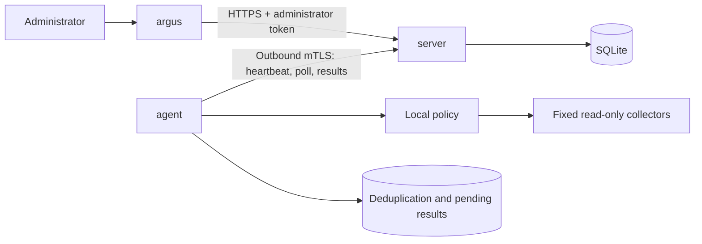

# Argus-C2

[简体中文](README.zh-CN.md)

Argus-C2 is a self-hosted Linux fleet diagnostics project. Administrators explicitly enroll nodes, request predefined read-only diagnostics through a CLI, and inspect node health and task results. Each agent connects outbound with its own client certificate and runs as a non-root user.

**Status: under development, before an MVP release.** Enrollment, mTLS, task dispatch, local policy enforcement, persistent results, client certificate renewal, and node disabling are implemented and locally tested. Deployment and sustained operation on five independent VPS instances remain unvalidated. The documentation describes the current implementation and its validation limits.

## Implemented diagnostics

| Task | Data | Parameters |
| --- | --- | --- |
| `system.info` | OS platform, architecture, hostname, kernel, boot time | `{}` |
| `system.metrics` | CPU, memory, configured disk paths and network interfaces | `{}` |
| `service.status` | Status of a locally allowlisted, already loaded systemd service | `{"service_id":"journal"}` |
| `network.listeners` | Local TCP listeners and unconnected UDP sockets | `{}` |
| `process.list` | Bounded process IDs, names, states, and UIDs | `{}` |
| `ssh.audit` | Limited observations of explicitly mapped SSH configuration or authorized-key files | `{"profile_id":"host"}` |

The example policy enables only system information and metrics. Other collectors require local opt-in. `SUCCEEDED` means a collector returned a valid report; inspect `available`, `coverage`, and `code` to determine whether the data is usable. Heartbeats update the hostname and last-seen time; they do not upload metrics. See [Collectors and results](docs/collectors.md).

## Three programs

| Program | Responsibility |
| --- | --- |
| `server` | Initialize a single CA and database, serve the HTTPS API, create database backups |
| `agent` | Enroll, poll, enforce local policy, collect diagnostics, retry results, renew its certificate |
| `argus` | List nodes, create tasks, inspect results, issue enrollment tokens, disable nodes |



Named administrator tokens have `Admin` or `ReadOnly` roles. Agents use individual node certificates, with disabling checked on every node request. Tasks bind a node and a unique ID, with separate dispatch deadlines and collection budgets; persistent execution records handle repeated delivery. Interrupted work can become `UNKNOWN`. Exactly-once execution is not promised.

There is no remote shell, arbitrary command or script execution, file manager, dynamic plugin loading, remediation, or remote self-update interface. The server is the trusted task-delivery authority. Fixed collectors and local policy restrict the diagnostics it can request, but the project does not claim to withstand a fully compromised management server or node root. See [Security boundaries](docs/security.md).

## Getting started

Build from the repository root with Go **1.27.3**:

```sh
mkdir -p bin
for command in server agent argus; do
  CGO_ENABLED=0 go build -trimpath -o "bin/$command" "./cmd/$command"
done
```

Follow the [local quick start](docs/quickstart.md) to complete a single-node workflow. Use [Linux deployment](docs/deployment.md) when preparing authorized test hosts. Agent enrollment, execution, and renewal require a non-root Linux user. Windows builds and selected tests do not establish Windows agent deployment support.

## Documentation

All primary documents are maintained in English. Chinese supplements are available for the README, quick start, and configuration reference.

| Document | Purpose |
| --- | --- |
| [Quick start](docs/quickstart.md) · [中文](docs/quickstart.zh-CN.md) | Build, enroll, and obtain the first result |
| [CLI reference](docs/cli.md) | Arguments, ordering, defaults, output, and exit behavior |
| [Configuration](docs/configuration.md) · [中文](docs/configuration.zh-CN.md) | Server, agent, administrator, and local policy fields |
| [Collectors and results](docs/collectors.md) | Report semantics, availability, and permissions |
| [HTTP API](docs/api.md) | Authentication, requests, responses, pagination, and limits |
| [Architecture and state](docs/architecture.md) | Task code path, SQLite model, and failure behavior |
| [Security boundaries](docs/security.md) | Trust assumptions, credentials, audit, and limitations |
| [Linux deployment](docs/deployment.md) | Accounts, permissions, systemd, and enrollment |
| [Operations](docs/operations.md) | Accounts, renewal, logs, backup, recovery, and troubleshooting |
| [Development and validation](docs/validation.md) | Test commands, evidence, CI, and remaining fleet acceptance |

Local result maintenance can list, export, retry, or explicitly discard report contents while retaining deduplication. Protocol version 1 is checked on every agent request; node listings expose the agent build. Local `storage` commands report database/WAL size, available space, and agent result capacity. See [Operations](docs/operations.md).

## Validation status

Local work has exercised unit and real TLS integration tests, race detection, vet, bounded fuzzing, and an actual-binary workflow with five local agents. A native systemd deployment CI fixture is provided; its status must be checked against a specific CI run. Five local agents do not replace deployment, sustained testing, and resource measurement on five independent VPS instances.
