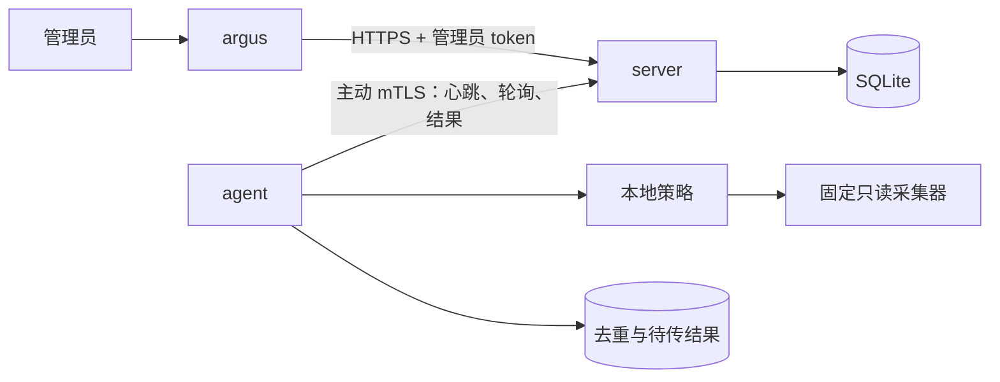

# Argus-C2

[English](README.md)

Argus-C2 是一个自托管的 Linux 节点诊断项目。管理员显式注册节点，通过 CLI 请求固定的只读诊断，再查询节点状态和采集结果。Agent 使用独立客户端证书主动连接服务器，以非 root 用户运行。

**项目仍在开发中，尚未发布 MVP。** 当前已实现并完成本地测试的内容包括注册、mTLS 通信、任务下发、本地策略、结果持久化、客户端证书续期和节点禁用。五台独立 VPS 的部署和持续运行尚未验收。这些文档描述当前代码及其验证范围。

## 已实现的诊断

| 任务 | 采集内容 | 参数 |
| --- | --- | --- |
| `system.info` | 操作系统平台、架构、主机名、内核、启动时间 | `{}` |
| `system.metrics` | CPU、内存、指定磁盘路径和网卡指标 | `{}` |
| `service.status` | 本地允许列表中已加载 systemd 服务的状态 | `{"service_id":"journal"}` |
| `network.listeners` | 本地 TCP 监听端口和未连接 UDP socket | `{}` |
| `process.list` | 有限的进程 ID、名称、状态和 UID | `{}` |
| `ssh.audit` | 显式映射的 SSH 配置或授权公钥文件的有限观察 | `{"profile_id":"host"}` |

示例策略只启用系统信息和指标，其他采集器需在节点本地放行。`SUCCEEDED` 表示采集器返回合法报告；具体数据是否可用，还要检查 `available`、`coverage`、`code`。心跳只更新主机名和最近收到心跳的时间，不自动上传指标。详见[采集器与结果](docs/collectors.md)。

## 三个程序

| 程序 | 职责 |
| --- | --- |
| `server` | 初始化单一在线 CA 和数据库，提供 HTTPS API、数据库备份、历史清理预览和执行 |
| `agent` | 注册、轮询、本地策略检查、采集、结果补传和证书续期 |
| `argus` | 查询节点、创建任务、读取结果、发放注册 token、禁用节点 |



管理员使用具名 token，角色为 `Admin` 或 `ReadOnly`。节点使用独立证书，每次请求检查禁用状态。任务绑定节点和唯一 ID，分别设定派发期限与采集预算；Agent 使用持久记录处理重复投递。中断任务可能为 `UNKNOWN`，不承诺 exactly-once 执行。

项目不提供远程 shell、任意命令或脚本、文件管理、动态插件、自动修复和远程自更新。Server 是受信任的任务下发方；固定采集器和本地策略限制它可请求的诊断范围，但项目不宣称能抵御管理服务器或节点 root 的完全失陷。详见[安全边界](docs/security.md)。

## 开始使用

在仓库根目录使用 Go **1.27.3** 构建：

```sh
mkdir -p bin
for command in server agent argus; do
  CGO_ENABLED=0 go build -trimpath -o "bin/$command" "./cmd/$command"
done
```

按[中文快速开始](docs/quickstart.zh-CN.md)完成单节点闭环；准备测试主机时使用[Linux 部署指南](docs/deployment.md)。Agent 的注册、运行和续期要求 Linux 非 root 用户；Windows 构建与部分测试不代表支持 Windows Agent 部署。

新 Linux Server 可使用[一键安装器](docs/server-installation.zh-CN.md)：交互选择域名或 IP，自动配置 HTTPS、证书续期、初始状态和 Agent 下载服务。发布包内置前端及两种架构的 Agent，目标机无需 Go 或 Node。

## 文档导航

| 文档 | 内容 |
| --- | --- |
| 快速开始：[English](docs/quickstart.md) / [中文](docs/quickstart.zh-CN.md) | 构建、注册到第一条任务结果 |
| [命令参考](docs/cli.md) | 参数、顺序、默认值和退出行为 |
| 配置参考：[English](docs/configuration.md) / [中文](docs/configuration.zh-CN.md) | Server、Agent、管理员与策略字段 |
| [采集器与结果](docs/collectors.md) | 数据含义、可用性与权限 |
| [HTTP API](docs/api.md) | 认证、请求响应、分页和限制 |
| [架构与状态](docs/architecture.md) | 任务代码路径、数据库与故障语义 |
| [安全边界](docs/security.md) | 信任假设、凭证、审计和限制 |
| [Linux 部署](docs/deployment.md) | 账户、权限、systemd 与注册 |
| [Server 一键安装](docs/server-installation.zh-CN.md) · [Agent 一键安装](docs/agent-installation.zh-CN.md) | 发布包、交互安装、域名／IP 证书和自动续期 |
| [日常运维](docs/operations.md) | 账号、续期、日志、备份恢复和排障 |
| [Web Console](docs/web-design.md) | React 界面、OIDC 会话、Admin 管理及 [Auth0 + GitHub／Google 配置](docs/console-auth0.zh-CN.md) |
| [开发与验证](docs/validation.md) | 测试命令、证据、CI 与后续验收 |

本地结果维护支持列出、导出、重试和显式删除报告内容，删除后仍保留去重依据。每次节点请求检查协议版本 1，节点列表可观察 Agent 构建版本。本地 `storage` 命令报告数据库/WAL 大小、可用空间及 Agent 结果容量。详见[运维说明](docs/operations.md)。

Server 历史清理由操作员手动执行：`server prune` 默认预览、保留 30 天，添加 `-apply -backup PATH` 后先生成验证过的快照，再删除符合条件的任务和结果。未完成任务继续保留；无结果 UNKNOWN 默认在 90 天后可清理，已收到报告从 Server 首次接收日起保留 30 天。时间计算边界与恢复后果见[运维说明](docs/operations.md#server-history-retention)。

`argus health` 检查 Server 数据库连接；节点 `active` 表示获得授权，`last_seen_at` 表示最近收到心跳的时间；任务 `SUCCEEDED` 表示有合法报告。它们都不能直接解释为节点健康，报告的数据可用性与覆盖范围需要单独判断。详见[状态语义](docs/architecture.md#status-dimensions)。

Server 要求 Schema 103，Agent 保持 Schema 101，组件标识各自独立；Schema 102 可通过 `server console-migrate` 备份后显式升级，启动时不会自动转换，其他不支持的版本仍会被拒绝。遵循[升级与恢复流程](docs/operations.md#database-compatibility-and-upgrades)。Offline Root + Online Intermediate 目前仍是 [PKI 规划](docs/security.md#offline-root-and-online-intermediate-plan)。

## 验证状态

本地已执行单元与真实 TLS 集成测试、race、vet、短时 fuzz，以及五个本地 Agent 的实际命令流程。基线 `8fe8997` 的 [CI 41864153776](https://github.com/Oreki0504/Argus-C2/actions/runs/41864153776) 已通过，包括 Windows 测试、原生 systemd 部署及隔离文件系统 ENOSPC 恢复；该证据只对应那个提交，后续修改见[验证记录](docs/validation.md)。本地五个 Agent 不能替代五台独立 VPS 的部署、72 小时持续测试和资源测量。
