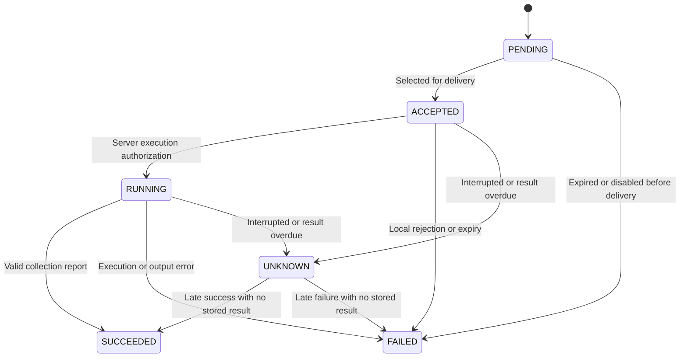

# Architecture and state

[Documentation](../README.md) · [API](api.md) · [Security boundaries](security.md)

Argus-C2 uses one server, SQLite, and Linux agents that poll for work. The server is the trusted task-delivery authority. Diagnostics run in fixed Go collectors; agents cannot load executable code from the network.

## Components and storage

| Component | Responsibility | Persistent state |
| --- | --- | --- |
| `server` | Enrollment, node authorization, administrator permissions, queue, results, audit | `argus.db`; local CA, TLS credentials, and administrator configuration |
| `agent` | Local policy, collection, deduplication, result retries, renewal | `probe.db`, private key, and client certificate |
| `argus` | Management requests, JSON output, waiting for results | Local administrator token file; no login-session database |

The server has a Fleet HTTPS listener and an optional independent Console HTTPS listener. Console uses Google OIDC, GitHub OAuth or custom OIDC with server-side Web sessions; its public projection is explicitly anonymous, while management requires a current Web Admin. Console does not expose Agent or CLI routes. See [Console architecture and limits](web-design.md).

On the Fleet listener, Enrollment and management routes do not require a client certificate: they check enrollment and administrator tokens respectively. Every agent route requires a verified client certificate. Node middleware validates the identity URI and protocol metadata without querying SQLite. Each business operation then checks certificate validity, fingerprints, and the disable flag inside the same transaction as its state change, including renewal. A malformed body may be rejected before that transaction; it cannot perform an authorized operation.

Agents do not listen on a management port. Each cycle attempts due renewal with a separate five-second budget, uploads pending results, sends a heartbeat, then polls for and executes at most one task. Renewal failure warns but does not block a still-valid certificate; retries are spaced up to five minutes apart (sooner near expiry). Invalid/expired certificates stop the cycle. The normal delay comes from local policy. Failures double the delay up to 60 seconds, plus less than one second of jitter. A heartbeat body carries `hostname`; request headers carry protocol/build metadata. The server records the receipt time and metadata. Metrics require a separate task.

## Status dimensions

| Dimension | Observation | What it establishes |
| --- | --- | --- |
| Server Health | Authenticated `GET /v1/health` returns `status: ok` after SQLite `PingContext` | The endpoint responded and its DB connection check passed; not a disk-write, CA-expiry, or fleet-health check |
| Node Online | `last_seen_at` is the server's last heartbeat receipt time, or 0 before the first heartbeat | Recent communication only; `active/disabled` is authorization state, not online/offline |
| Task Execution | `PENDING`, `ACCEPTED`, `RUNNING`, `SUCCEEDED`, `FAILED`, `UNKNOWN` | Delivery/execution outcome for one assignment; success does not rate the host |
| Diagnostic Availability | Report `available`, `coverage`, `truncated`, `code`, and per-resource fields | Which observations were usable and where coverage was incomplete |

There is no computed online field or universal stale-heartbeat threshold. Choose an observation window that includes the configured poll delay, request/collection time, and retry backoff. A recent heartbeat cannot guarantee current connectivity. An active node can be offline, and a SUCCEEDED service query can report `available:false`.

## Following a task

1. [cmd/argus](../cmd/argus/main.go) creates a strict `TaskRequest` and sends it through [transport](../internal/transport/client.go) to `POST /v1/tasks`.
2. [api](../internal/api/http.go) verifies the administrator and Admin role. [database.CreateTask](../internal/database/tasks.go) checks parameters, node status, and queue capacity, then writes the task and audit event in one transaction.
3. When a node polls, the server first returns an unfinished task already selected for delivery. Otherwise it changes one `PENDING` task to `ACCEPTED` and returns it. Server-side `ACCEPTED` **means selected for delivery; it does not prove receipt or durable acceptance by the agent**.
4. Transport checks protocol compatibility before the agent processes a task. [agent.Engine](../internal/agent/engine.go) validates the assignment and node binding, consults or records the task ID through [State](../internal/agent/state.go), then checks expiry and local policy. An identical completed task returns its stored result.
5. Before collection, the agent requests a server transition to `RUNNING`, then persists `RUNNING` locally. [collectors.Execute](../internal/collectors/execute.go) invokes the fixed registry entry with a fresh duration bounded by the task execution budget and local policy. Dispatch expiry does not truncate an authorized collection.
6. The agent validates the report and output size, persists the result, then uploads it. The server validates ownership, report structure, and resource binding, and atomically commits the result, first server receipt time, terminal state, and audit event. SUCCEEDED additionally requires a persisted execution authorization; ACCEPTED cannot directly succeed, and UNKNOWN can succeed only if it previously obtained a grant. The authorization timestamp survives expiry and audit trimming. The agent marks the local result acknowledged only after a successful response.

The registry, policy, and HTTP layer are separate. Collectors do not know the server address and have no interface for changing policy or executing arbitrary commands.

## Task states

| State | Server meaning | Possible subsequent changes |
| --- | --- | --- |
| `PENDING` | Waiting for delivery | `ACCEPTED`; `FAILED` on expiry or disable |
| `ACCEPTED` | Selected for a poll response, possibly not received by the agent | `RUNNING`; rejection, expiry, or recovery result; `UNKNOWN` after the result deadline |
| `RUNNING` | Server approved execution; this does not prove collection started | `SUCCEEDED`, `FAILED`, `UNKNOWN` |
| `SUCCEEDED` | A valid success report is stored | An existing result cannot be overwritten |
| `FAILED` | A failure result is stored | An existing result cannot be overwritten |
| `UNKNOWN` | No reliable, definitive execution outcome | Whether a later result can resolve it depends on whether a `result` is already stored |

There are two forms of `UNKNOWN`:

- **Server-inferred timeout:** a delivered task with no result at `result_due_at` becomes `UNKNOWN`, without a fabricated `result`. A later upload can resolve it if the node remains authorized and the task still has no stored result.
- **Persisted unknown result:** agent restart recovery, recovery after result persistence failed, or disabling an in-flight task produces an `UNKNOWN` result. Like any stored result, it cannot be overwritten with a different outcome.

`argus wait` treats either form as finished and exits nonzero. Use `result` to check for a later upload. Expiry maintenance runs during task creation, polling, and task queries, not in a background timer. An idle system does not proactively update every expired task at a precise instant.

## Time boundaries

`dispatch_expires_at` is the last instant for first server execution authorization. `execution_timeout_ms` is 1–30,000 ms, further limited by local policy. Its monotonic duration starts after successful authorization and durable local RUNNING. `result_due_at` initially equals dispatch expiry plus 60 seconds; first execution authorization sets it to server time plus the execution budget rounded up to seconds, plus 60 seconds. Authorization retries never extend it.

Result due time only triggers an UNKNOWN inference. It is not a permanent upload cutoff. A still-authorized node can submit a late result while the task has no stored result, and an identical committed result remains retryable while retained. Explicit history pruning ends that retry guarantee for deleted rows; later uploads receive `task_not_found`. Expiry maintenance is transactional and request-driven.

## Result delivery and local disposal

Delivery state is separate from execution state: `pending`, `held`, `acknowledged`, or `discarded`. Explicit task/result rejection codes move reports to `held`, retaining their contents and capacity charge. Transient and unclassified errors preserve `pending`. Upload batches have a ten-second budget; a failed batch still allows a heartbeat attempt, but transient or protocol failures defer new polling.

Local maintenance can export a report, retry a held report, or explicitly discard report contents. Discard preserves the assignment, terminal execution state, and deduplication record; it neither acknowledges delivery nor cancels the server task. Repeated delivery cannot reexecute held or discarded work. See [Operations](operations.md).

## Repeated delivery, crashes, and retries

The local task ID is a SQLite primary key, and acceptance is persisted before execution. A process lock prevents two workers from opening the same state, while an in-process lock serializes task handling. Reusing an ID with a different node, type, parameters, validity period, or other assignment content is rejected.

On restart, local `ACCEPTED` and `RUNNING` records become `UNKNOWN` and await upload; they do not rerun automatically. If result persistence fails while the process remains alive, the existing `RUNNING` record also becomes unknown on redelivery instead of triggering another collection. A failed execution-grant request immediately enters local reconciliation: recognized denials become FAILED/execution_authorization_rejected; unclassified responses and transport failures become UNKNOWN/execution_authorization_uncertain. No collection or new grant attempt occurs for that ID. Recovery does not depend on redelivery, and failed persistence blocks new execution until saved; restart also conservatively recovers unfinished records. If the RUNNING write fails, collection is forbidden and the task becomes UNKNOWN once storage recovers. If UNKNOWN cannot be saved, the agent blocks new execution until that recovery succeeds.

If an upload response is lost, the agent retains its unacknowledged result. Repeating the same upload succeeds; a conflicting terminal result returns 409. Validated reports are compared as typed values: object-key order and whitespace are irrelevant, while integer precision, array order, error codes, and completion timestamps remain significant. Agents retain the original result and never regenerate timestamps on retry. A crash after receiving an acknowledgment but before persisting it can cause another idempotent upload.

These behaviors do not provide exactly-once execution. Restoring an old agent snapshot, removing deduplication state, reenrolling, or creating another task ID changes the deduplication boundary. Administrators create a new task when they need a fresh observation.

## SQLite model

The original Fleet state uses five tables:

| Table | Main contents |
| --- | --- |
| `nodes` | ID, hostname, status, last heartbeat, current certificate and fingerprint, expiry, one previous fingerprint and its deadline |
| `enrollment_tokens` | Token digest, expiry, bound node ID and CSR public-key fingerprint |
| `tasks` | ID, node, task type, JSON parameters, state, creation time, dispatch deadline, execution budget, result due time, persisted execution-authorization time |
| `results` | One result per task ID: node, status, JSON payload, error code, agent completion time, first server receipt time |
| `audit_events` | Increasing ID, timestamp, actor, action, node, task, status |

The agent uses `identity` and `executions` to store its fixed node identity, original tasks, execution states, complete results, delivery dispositions, and dispatch expiry. Server uses schema version `103` and agent uses `101`, with distinct SQLite application IDs (`ARGS` and `ARGA`). Both reject unsupported or wrong-component databases without resetting them. Schema 103 adds `console_state`, `console_users` and `console_nodes`, an audit subject column, indexes and the public-ID registration trigger. `server console-migrate` explicitly upgrades 102 after a verified backup; startup never converts state automatically. Provider credentials are separate private files, and browser sessions are bounded memory state.

Storage uses standard SQLite transactions, foreign keys, WAL, `synchronous(FULL)`, a two-second busy timeout, and at most one connection per Store pool. Audit events and their associated state changes share a transaction; an audit write failure rolls back the operation.

## Capacity and cleanup

| Object | Current handling |
| --- | --- |
| Per-node `PENDING/ACCEPTED/RUNNING` tasks | Maximum 100; further creation returns a conflict |
| Enrollment tokens | Expired entries are removed during creation; creation is rejected if 1,000 entries remain |
| Audit | Old entries are removed by increasing ID on append; approximately 100,000 events are retained |
| Agent pending/held results | Acceptance atomically reserves one 64 KiB result; total count is at most 1,000 and reserved plus actual UTF-8 result bytes at most 32 MiB |
| Agent acknowledged/discarded records | Deduplication remains until more than 24 hours after dispatch expiry; expired tasks still cannot execute after cleanup |
| Server task and result history | Manual `server prune`: preview by default; 30 days from first result receipt, 90 days after deadlines for UNKNOWN without results; 200-record batch by default, maximum 1,000; apply requires verified backup |

These application limits are not disk quotas. Full filesystems, I/O failures, and extended outages can still affect availability.

Pruning requires either matching terminal task/result rows with server `received_at` strictly older than the result cutoff, or UNKNOWN without a result whose dispatch and result deadlines are both strictly older than the UNKNOWN cutoff. Agent completion time does not control retention. Unfinished work stays in place. The batch is frozen before backup and rechecked in the deletion transaction; audit failure, stale candidates, or failed deletes roll back the entire batch. `task.prune` records IDs and original terminal state. Prior audit remains subject to its existing 100,000-event bound. Cleanup does not reset agent deduplication, reenroll nodes, or permit caller-selected task IDs. See [retention and recovery](operations.md#server-history-retention).

## Code map

| Path | Responsibility |
| --- | --- |
| [cmd](../cmd/) | Three command entry points |
| [internal/api](../internal/api/) / [auth](../internal/auth/) | Routes, roles, credential verification |
| [internal/config](../internal/config/) / [policy](../internal/policy/) | Local configuration and permissions |
| [internal/database](../internal/database/) | Server transactions, queue, nodes, audit, backup |
| [internal/enrollment](../internal/enrollment/) | Single CA, enrollment, renewal |
| [internal/agent](../internal/agent/) | Cycle, identity files, execution, local state |
| [internal/collectors](../internal/collectors/) | Six fixed collectors |
| [internal/protocol](../internal/protocol/) / [transport](../internal/transport/) | Types, validation, standard HTTPS |
| [internal/resources](../internal/resources/) / [saferead](../internal/saferead/) | Local resource mappings and file boundaries |
| [internal/localfile](../internal/localfile/) / [localdb](../internal/localdb/) / [strictjson](../internal/strictjson/) / [identity](../internal/identity/) | File, database, parsing, and identity utilities |
